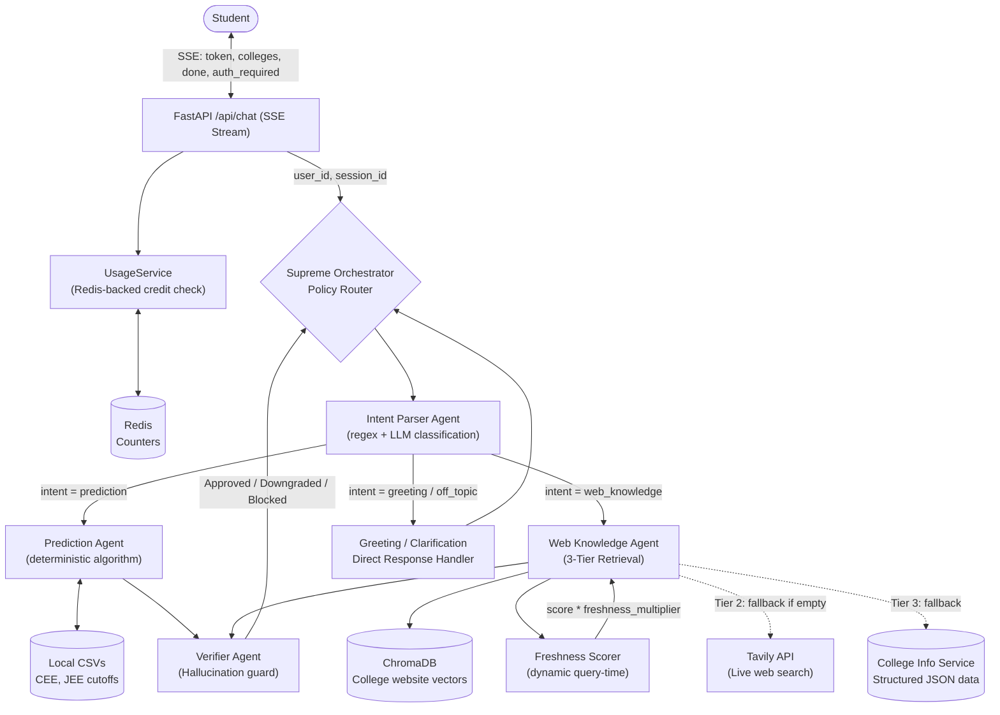
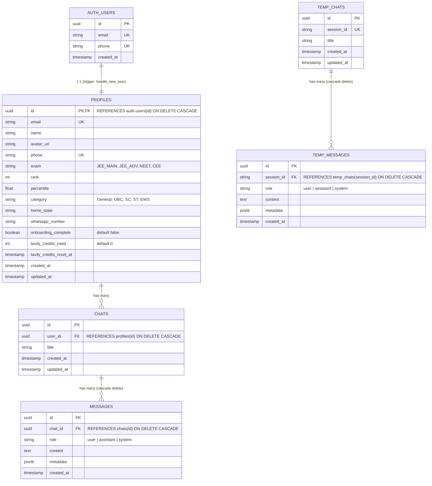

# RankRoute System Architecture

RankRoute is a production-grade, AI-powered college admission counselor designed to provide **deterministic rank predictions** and **up-to-date college information** for Indian engineering entrance exams (JEE Main, JEE Advanced, Assam CEE, NEET). It operates on a policy-driven, multi-agent AI architecture backed by a scalable, asynchronous infrastructure with zero-trust RAG, freemium usage gates, and deep observability.

---

## 1. High-Level System Design

The system is fully decoupled into a modern web stack, a Python-based API, an asynchronous worker queue, and multiple data layers.

```
┌─────────────────────────────────────────────────────────────────────┐
│                         CLIENT (Browser)                           │
│  ┌─────────────┐  ┌──────────────┐  ┌───────────────────────────┐ │
│  │  Next.js 15  │  │  AuthProvider│  │  useChats (Hook)          │ │
│  │  React 19    │  │  (Supabase)  │  │  SSE Streaming           │ │
│  │  Tailwind 4  │  │  httpOnly    │  │  Optimistic Updates      │ │
│  └──────┬───────┘  │  Cookies     │  └───────────┬───────────────┘ │
│         │          └──────┬───────┘              │                 │
└─────────┼─────────────────┼──────────────────────┼─────────────────┘
          │                 │                      │
     HTTPS:9000        Credentials:          SSE Events:
          │             'include'            token, colleges,
          │                                  done, auth_required
          ▼                 ▼                      ▼
┌─────────────────────────────────────────────────────────────────────┐
│                    CADDY (Reverse Proxy)                            │
│  • Rate limiting: 10 req/s per IP, burst 20                        │
│  • SSE support: flush_interval -1 (no buffering)                   │
│  • Security: /docs, /redoc blocked in production (403)             │
│  • Health check bypasses rate limiter                              │
└──────────────────────────┬──────────────────────────────────────────┘
                           │
                           ▼
┌─────────────────────────────────────────────────────────────────────┐
│                     GUNICORN + UVICORN (4 workers)                  │
│                         FastAPI Application                         │
│                                                                     │
│  ┌──────────────────────────────────────────────────────────────┐  │
│  │                    MIDDLEWARE STACK                           │  │
│  │  ┌──────────────┐  ┌──────────────┐  ┌───────────────────┐  │  │
│  │  │    CORS      │  │  RequestCtx  │  │  RateLimit (all   │  │  │
│  │  │  (explicit)  │  │  Middleware  │  │  /api/* routes)   │  │  │
│  │  └──────────────┘  └──────────────┘  └───────────────────┘  │  │
│  │  ┌──────────────────┐  ┌─────────────────────────────────┐  │  │
│  │  │ TracingMiddleware│  │  Global Exception Handler       │  │  │
│  │  │   (LangSmith)    │  │  (sanitized in production)      │  │  │
│  │  └──────────────────┘  └─────────────────────────────────┘  │  │
│  └──────────────────────────────────────────────────────────────┘  │
│                                                                     │
│  ┌──────────┐ ┌──────────┐ ┌──────────┐ ┌──────────┐ ┌─────────┐  │
│  │ /api/chat│ │ /api/auth│ │/api/chats│ │/api/scrape│ │/api/prof│  │
│  │ (SSE)    │ │(OTP,OAuth│ │(CRUD)    │ │(Ingest)  │ │(Profile)│  │
│  └────┬─────┘ │  /sess)  │ └──────────┘ └──────────┘ └─────────┘  │
│       │       └──────────┘                                        │
│       ▼                                                            │
│  ┌──────────────────────────────────────────────────────────────┐  │
│  │              SUPREME ORCHESTRATOR                             │  │
│  │  ┌──────────┐ ┌──────────┐ ┌──────────┐ ┌────────────────┐ │  │
│  │  │  Intent  │ │Prediction│ │   Web    │ │  Greeting/Off  │ │  │
│  │  │  Parser  │ │  Agent   │ │Knowledge │ │  Topic Handler │ │  │
│  │  └──────────┘ └────┬─────┘ │  Agent   │ └────────────────┘ │  │
│  │                    │       └──────────┘                      │  │
│  │                    │            │                            │  │
│  │                    ▼            ▼                            │  │
│  │              ┌─────────────────────────┐                     │  │
│  │              │     VERIFIER AGENT       │                     │  │
│  │              │  Approve / Downgrade /   │                     │  │
│  │              │  Block hallucination     │                     │  │
│  │              └─────────────────────────┘                     │  │
│  └──────────────────────────────────────────────────────────────┘  │
└──────────────────────────┬──────────────────────────────────────────┘
                           │
            ┌──────────────┼──────────────────┬──────────────────┐
            ▼              ▼                  ▼                  ▼
┌─────────────────┐ ┌──────────┐ ┌──────────────────┐ ┌──────────────┐
│   Supabase DB   │ │ ChromaDB │ │   Redis (6)      │ │  Local CSVs  │
│  (PostgreSQL)   │ │ (Vector) │ │ • Celery broker  │ │  (CEE, JEE)  │
│  • Profiles     │ │ • College│ │ • Usage counters │ │  • Cutoffs   │
│  • Chats        │ │   website│ │ • Rate limit     │ │  • Rank data │
│  • Messages     │ │   chunks │ │ • OTP metadata   │ │              │
│  • Temp sessions│ │          │ │ • URL dedup      │ │              │
└─────────────────┘ └──────────┘ └──────────────────┘ └──────────────┘
                           │
                           ▼
┌─────────────────────────────────────────────────────────────────────┐
│                   CELERY WORKER (Background)                        │
│  ┌────────────────────┐  ┌────────────────────┐                    │
│  │  Ingestion Queue   │  │  Admin Alerts      │                    │
│  │  • scrape + chunk  │  │  • 50%/90% Tavily  │                    │
│  │  • embed + upsert  │  │  • Daily digests   │                    │
│  │  • self-heal ingest│  │                    │                    │
│  └────────────────────┘  └────────────────────┘                    │
│  ┌────────────────────┐                                            │
│  │  Celery Beat       │                                            │
│  │  • Weekly rescrape │                                            │
│  │  • Daily digest    │                                            │
│  └────────────────────┘                                            │
└─────────────────────────────────────────────────────────────────────┘
```

### Infrastructure Stack (Docker Compose — 6 services)

| Service | Role | Base Image | Scale |
|---------|------|------------|-------|
| **`api`** | FastAPI via Gunicorn + Uvicorn | `python:3.13-slim` (multi-stage) | 4 workers |
| **`worker`** | Celery worker (ingestion, alerts) | `python:3.13-slim` | 2 concurrency |
| **`beat`** | Celery Beat scheduler | `python:3.13-slim` | 1 replica |
| **`redis`** | Message broker + cache + usage counters | `redis:7-alpine` | 1 node |
| **`caddy`** | Reverse proxy + rate limiter | `caddy:2` + `xcaddy` rate-limit plugin | 1 replica |

### Data Layer

| Store | Technology | Purpose |
|-------|-----------|---------|
| **Relational DB** | Supabase (PostgreSQL) | User profiles, chat history, anonymous sessions. RLS policies enforce data isolation. |
| **Vector DB** | ChromaDB (persistent at `./data/chroma`) | Dense vector embeddings (`all-MiniLM-L6-v2`) of scraped college websites. Version-tagged to prevent staleness. |
| **Cache & Counters** | Redis (6 logical DBs) | Celery broker, usage counters (atomic Lua scripts), rate limiting, OTP metadata, URL dedup set. |
| **Structured Data** | Local CSV files | Deterministic rank prediction — `cee_cutoffs.csv`, `jee_cutoffs.csv`. Read at query time, never embedded. |

---

## 2. AI Multi-Agent Architecture

The legacy monolithic RAG pipeline has been completely replaced by a **Policy-Driven Multi-Agent Orchestrator**. The AI does not blindly search a database; it routes queries intelligently through specialized agents, each with strict boundaries.



### Flow of a Request

1. **SSE Connection**: The frontend opens a POST request to `/api/chat` with `Accept: text/event-stream`. The backend streams tokens via Server-Sent Events.

2. **Auth & Quota Gate** (`usage_service.py`):
   - For anonymous users: checks atomic Redis counter (`anon:prompts:{session_id}`) via Lua script. If > 3 prompts, returns `{type: "auth_required"}` SSE event.
   - For authenticated users: checks Tavily monthly limit (`auth:tavily:{user_id}:{YYYY-MM}`).
   - **Fail-open**: If Redis is unreachable, the gate allows the request (graceful degradation).

3. **Supreme Orchestrator** (`orchestrator.py`):
   - Attaches `user_id` and `session_id` to the `RequestFrame`.
   - Delegates to Intent Parser. On return, routes to the appropriate agent.

4. **Intent Parser** (`intent_agent.py`):
   - Classifies query into: `greeting`, `prediction` (rank-based), `web_knowledge` (info/lookup), `off_topic`, or `clarification`.
   - Uses regex patterns + LLM fallback for ambiguous queries.

5. **Specialized Agents**:

   - **Prediction Agent**: Uses deterministic algorithms against CSV cutoff data. No LLM involved — returns exact college/branch predictions for a given rank, category, and exam.

   - **Web Knowledge Agent (3-Tier Retrieval)**:
     - **Tier 1**: Query ChromaDB with freshness-adjusted scoring (`adjusted_score = relevance × freshness_multiplier`). Multiplier ranges from 1.0 (current) to 0.5 (archive).
     - **Tier 2**: If ChromaDB returns empty, triggers Tavily live web search restricted to official `.ac.in`, `.edu.in` domains. Results pass through **Zero-Trust Interceptor** — only official/educational sources are trusted; unofficial sources require 2+ source consensus.
     - **Tier 3**: Falls back to structured local data (`college_info_service.py`) for fee/placement info.

6. **Freshness Scorer** (dynamic, query-time):
   - Computes `days_old` from `scraped_at` metadata vs current time.
   - Assigns bucket: `current` (<30d), `recent` (<90d), `stale` (<180d), `archive` (>=180d), `unknown`.
   - Multiplies relevance score by bucket multiplier — archive chunks rank lower but still appear.

7. **Verifier Agent** — the hallucination guard:
   - Ensures rank claims are backed by deterministic CSV evidence.
   - Ensures freshness claims have a verifiable recent source.
   - Can **downgrade** (remove unsupported claims) or **block** (force clarification question) a response.

8. **Self-Healing Loop**:
   - When Tavily discovers a new official URL, a Celery task (`self_heal_ingest`) permanently ingests it into ChromaDB with version-tagging (`scrape_version`).
   - Old versions are purged after the new data is confirmed (zero-downtime swap).

### Policy Engine

The orchestrator uses separate policy modules for each concern:

| Policy | File | Responsibility |
|--------|------|---------------|
| Routing Policy | `routing_policy.py` | Maps intent to agent |
| Budget Policy | `budget_policy.py` | Controls per-request token/API spend |
| Source Policy | `source_policy.py` | Approves/denies data sources by trust tier |
| Retrieval Policy | `retrieval_policy.py` | Configures ChromaDB query parameters |
| Verification Policy | `verification_policy.py` | Sets verifier strictness per intent |
| Fallback Policy | `fallback_policy.py` | Controls Tavily/local fallback triggers |

---

## 3. Frontend Architecture

The frontend is a **Next.js 15** app with **React 19**, **TypeScript 5**, **Tailwind CSS 4**, and **zero client-side auth SDKs**.

### Directory Structure

```
frontend/
├── app/
│   ├── layout.tsx          # Root layout: AuthProvider + Toaster
│   ├── page.tsx            # Entry: auth gate → LandingAuth or ApplicationLayout
│   └── globals.css         # Tailwind imports + custom scrollbar
├── components/
│   ├── application-layout.tsx   # Shell: sidebar + chat area orchestration
│   ├── chat-area.tsx            # SSE stream, message display, input
│   ├── sidebar.tsx              # Chat list with date grouping via useMemo
│   ├── landing-auth.tsx         # 3-step auth: email → OTP → onboarding
│   ├── settings-modal.tsx       # Profile editing, sign out, guest CTA
│   ├── clear-chats-modal.tsx    # Confirmation dialog
│   ├── phone-sign-in.tsx        # 2-step phone OTP form
│   └── typewriter-greeting.tsx  # Animated cycling greeting text
├── hooks/
│   ├── use-chats.ts        # Chat lifecycle: CRUD + anon sessions
│   └── use-mobile.ts       # Responsive breakpoint detection (unused)
├── lib/
│   ├── auth-context.tsx    # AuthProvider + useAuth() hook
│   ├── api.ts              # Centralized fetchApi() wrapper
│   ├── types.ts            # TypeScript interfaces matching backend
│   └── utils.ts            # cn() tailwind-merge utility
└── middleware.ts           # Pass-through (auth enforced server-side)
```

### Key Architectural Decisions

| Decision | Rationale |
|----------|-----------|
| **No client-side auth SDK** | All auth flows through backend API with `httpOnly` cookies. Zero Supabase/Clerk keys exposed to the browser. |
| **Derived message state** | `displayMessages` is a `useMemo` over `messages` prop + `streamingMessages` overlay. No `useEffect` sync — eliminates stale closure bugs that caused wrong history to be sent to the API. |
| **SSE with fetch-event-source** | `@microsoft/fetch-event-source` handles reconnection, event parsing, and cancellation. Backend sends structured JSON events (`type: token`, `type: colleges`, `type: done`). |
| **Chat grouping on client** | Sidebar groups chats by Today/Yesterday/Last 7 Days/Older using `useMemo` with `updated_at` timestamps. No backend computation needed. |
| **FingerprintJS for guest IDs** | Resilient, incognito-proof visitor tracking for anonymous session persistence, with `crypto.randomUUID()` fallback. |

### State Management

All chat state lives in the `useChats()` custom hook:

```
useChats()
├── chats: Chat[]              # List of all user chats
├── messages: Message[]        # Active chat messages (persisted)
├── activeChatId: string|null  # Currently selected chat
├── anonSessionId: string|null # Anonymous session fingerprint
├── isLoadingList: boolean     # Chat list loading
├── isLoadingMessages: boolean # Message loading
├── selectChat(id)             # Load chat messages
├── createNewChat(title)       # Create (generates UUID for anon)
├── saveMessages(user, asst)   # Save both + trigger background refresh
├── renameChat(id, title)
├── deleteChat(id)
└── refreshChats()             # Re-fetch chat list
```

When not streaming, `messages` prop is the display source. When streaming, `streamingMessages` overlay takes over. On stream completion, the `finally` block resets `streamingMessages = null`, auto-syncing to the just-persisted `messages` prop — zero effects needed.

### SSE Protocol

| Event Type | Direction | Payload | Frontend Action |
|------------|-----------|---------|-----------------|
| `token` | Backend → Frontend | `{"type":"token","data":"text"}` | Append to streaming message content |
| `colleges` | Backend → Frontend | `{"type":"colleges","data":[...]}` | Store prediction metadata |
| `done` | Backend → Frontend | `{"type":"done","tavily_skipped":true}` | Signal stream end; call `onStreamComplete()` |
| `auth_required` | Backend → Frontend | `{"type":"auth_required"}` | Remove temp messages, show login toast |
| `error` | Backend → Frontend | `{"type":"error","data":"msg"}` | Log error, show toast |

---

## 4. Authentication System

RankRoute uses a **custom auth layer** built on Supabase Auth, with no third-party auth SDKs on the frontend.

### Auth Flow

```
                        ┌──────────────────────┐
                        │   Supabase Auth API   │
                        │  (Email OTP / Google  │
                        │   OAuth)              │
                        └──────────┬───────────┘
                                   │
                          Backend sets httpOnly
                          cookies (sb_access_token,
                          sb_refresh_token)
                                   │
                                   ▼
┌──────────┐          ┌──────────────────────┐          ┌──────────┐
│  User    │─────────▶│  Frontend AuthProvider│─────────▶│  Backend │
│          │          │  GET /api/auth/session│          │  verifies│
│          │          │  (credentials:include)│          │  JWT from│
│          │          │  Returns {user,       │          │  cookie  │
│          │          │  isLoaded, isSignedIn}│          │          │
└──────────┘          └──────────────────────┘          └──────────┘
```

### Auth Providers

| Method | Endpoint | Flow |
|--------|----------|------|
| **Email OTP** | `POST /api/auth/email/send-otp` | Send email → receive 6-digit code → `POST /api/auth/email/verify` |
| **Google OAuth** | `GET /api/auth/google` | Redirect → Supabase consent → callback sets cookies → redirect to app |
| **Session** | `GET /api/auth/session` | Returns authenticated user from httpOnly cookie |
| **Logout** | `POST /api/auth/logout` | Clears httpOnly cookies |

### Security Properties

| Property | Implementation |
|----------|---------------|
| Token storage | `httpOnly` cookies — not accessible via JavaScript |
| Cookie security | `Secure` flag enabled in production (`not settings.debug`) |
| CSRF protection | `SameSite=Lax` on all cookies; credentials included via `credentials: 'include'` |
| Token refresh | `/api/auth/refresh` endpoint exchanges refresh token for new access token |
| Email validation | `EmailValidator` blocks disposable/temporary email domains, strips Gmail aliases |
| Profile enrichment | Passive NLP extraction of exam/rank/category from chat messages (Celery task, no latency impact) |

---

## 5. Freemium Gate & Usage Enforcement

To protect expensive API keys (LLM inference, Tavily web search credits), RankRoute implements a strict usage enforcement system backed by **atomic Redis counters** using custom Lua scripts.

### Redis Key Schema

```
# Anonymous limits
anon:prompts:{session_id}           TTL: 7 days
anon:tavily:{session_id}            TTL: 30 days

# Authenticated limits
auth:tavily:{user_id}:{YYYY-MM}     TTL: 35 days

# Global quota tracking
tavily:global:{YYYY-MM}             TTL: 35 days

# Alert dedup
tavily:alert:sent:{YYYY-MM}:50pct   TTL: 35 days
tavily:alert:sent:{YYYY-MM}:90pct   TTL: 35 days

# OTP metadata
otp:meta:{phone}                    TTL: 10 min
```

### Atomicity Guarantee

All credit checks use a **single Redis Lua script** shipped in `usage_service.py`:

```lua
local current = redis.call('INCR', KEYS[1])
if current == 1 then
    redis.call('EXPIRE', KEYS[1], ARGV[2])
end
if current > tonumber(ARGV[1]) then
    redis.call('DECR', KEYS[1])
    return {0, tonumber(ARGV[1])}
end
return {1, tonumber(ARGV[1]) - current}
```

This prevents race conditions where concurrent requests could push the counter past the limit before a `DECR` undoes it — a critical fix applied in Phase 16.

### Usage Limits

| User Type | Prompts | Tavily Searches | Reset |
|-----------|---------|-----------------|-------|
| Anonymous (guest) | 3 total | 1 total | Never (until login) |
| Authenticated | Unlimited | 5 per month | Auto-resets 1st of month |

### Admin Alert System

A background Celery worker monitors the global Tavily pool:

| Threshold | Action |
|-----------|--------|
| 50% of monthly quota | Warning email to admin via SMTP |
| 90% of monthly quota | Critical email alert |
| Daily (9 AM UTC) | Digest email with current usage stats |

---

## 6. Observability & Fail-Open Design

### LangSmith Tracing

All agentic flow steps are traced via LangSmith's `TracingMiddleware`:

```
HTTP POST /api/chat
└── supreme_orchestrator.handle_request()
    ├── intent_agent.parse()
    ├── prediction_agent.predict()          [if intent=prediction]
    ├── web_knowledge_agent.retrieve()      [if intent=web_knowledge]
    │   ├── chroma_client.query()
    │   ├── web_search.search()            [fallback]
    │   └── college_info_service.get()     [Tier 3 fallback]
    └── verifier_agent.verify()
```

### Fail-Open Behavior

| Dependency Failure | System Behavior |
|-------------------|-----------------|
| **Redis unreachable** | Usage gate allows all requests (counters bypassed). No crash. |
| **Tavily API down** | Web Knowledge Agent falls through to Tier 3 (local data). LLM instructed to hedge: "Live search unavailable." |
| **ChromaDB empty/corrupt** | Falls to Tier 2 (Tavily) then Tier 3 (local data). No blank responses. |
| **Supabase offline** | Chat SSE streaming still works (anonymous path). Auth check returns `unauthenticated`. |

---

## 7. Freshness & Staleness Strategy

ChromaDB chunks stored with version-tagged metadata to prevent stale data from serving forever.

### Hybrid Purge Strategy

| Ingestion Path | Timing | Strategy | Risk |
|---------------|--------|----------|------|
| Weekly cron (`run_ingestion_job`) | 3 AM Monday | Delete all chunks for URL → upsert fresh | Near-zero (no traffic at 3 AM) |
| Self-heal (`self_heal_ingest`) | During user session | Write new chunks with `scrape_version` → confirm → purge old versions | Zero (old data serves reads until new is ready) |

### Query-Time Freshness Scoring

Freshness is NOT stored in ChromaDB metadata — it is computed dynamically at query time:

| Bucket | Age | Multiplier |
|--------|-----|------------|
| `current` | <30 days | 1.0 |
| `recent` | <90 days | 0.9 |
| `stale` | <180 days | 0.7 |
| `archive` | >=180 days | 0.5 |
| `unknown` | No date | 0.6 |

`adjusted_score = relevance_score × freshness_multiplier`

Results are sorted by adjusted score before presentation to the LLM, ensuring fresher relevant data ranks higher.

---

## 8. Phase 16 Quality Audit

A comprehensive council-based audit (4 specialized agents: React, Python, DevOps, ESLint) identified and resolved 50+ issues across the entire codebase.

### What Was Fixed

| Domain | Issues | Resolution |
|--------|--------|------------|
| **ESLint** | 7 errors | Lazy useState initializers, derived state via useMemo, inlined effect logic, escaped entities |
| **TypeScript** | 1 type error | Null iterator guard for `Message[] \| null` |
| **Critical bugs** | Dual message state (stale closures), infinite SSE retry loop | Derived state pattern, removed `throw err` in onerror |
| **Backend security** | CORS `["*"]` fallback, `secure=False` cookies, exception handler leaking details | Explicit origins, dynamic secure flag, gated detail |
| **Race conditions** | 3 non-atomic `INCR`+`DECR` pairs | Single atomic Lua script |
| **Async correctness** | `embeddings.py` async methods blocking event loop | `run_in_executor` |
| **Rate limiting** | Only covered `/api/agents/*` | Extended to all `/api/*` routes |
| **Dead code** | 409 lines across 2 files | Deleted `query_parser.py`, `education_schema.py` |
| **Unused deps** | 3 Python packages | Removed `python-dotenv`, `sqlalchemy`, `aiosqlite` |
| **Tailwind v4** | 2 dynamic `z-${N}` classes silently failing | Static class arrays |
| **Accessibility** | No focus trap, no aria on modals, no keyboard support | 2 modals with focus trap + aria, `focus-visible` on action buttons |
| **Infrastructure** | No `.dockerignore`, no root `.gitignore`, port drift | Created both files, aligned config defaults |

### Verification Gates

| Gate | Status |
|------|--------|
| ESLint (npm run lint) | ✅ 0 errors, 0 warnings |
| TypeScript (tsc --noEmit) | ✅ 0 errors |
| Next.js build (npm run build) | ✅ Compiled + linted + built |
| Python syntax (ast.parse) | ✅ All files pass |
| Backend Python dependencies | ✅ Cleaned (3 removed) |

---

## 9. Entity-Relationship Diagram

The data layer is built on **Supabase (PostgreSQL)** with strict isolation between authenticated and anonymous flows. The `auth.users` table is managed internally by Supabase Auth. All data-modifying operations go through the backend API — no direct database access from the frontend.



### Key Schema Design Decisions

| Decision | Rationale |
|----------|-----------|
| **Separate temp_* tables** | Anonymous user data is fully isolated from authenticated data. Transfer is a one-time `INSERT ... SELECT` + `DELETE` operation when a guest signs up. |
| **No FK from temp_chats to profiles** | Anonymous sessions are ephemeral — no FK constraint needed. The `session_id` is a UUID stored in `localStorage`. |
| **`ON DELETE CASCADE` on chats → messages** | Deleting a chat automatically cleans up all messages. The application also uses batch `DELETE` via the `/api/chats/clear` endpoint. |
| **`onboarding_complete` boolean** | Enables a progressive onboarding flow: email → OTP → exam details → chat. The flag gates whether the user sees the onboarding wizard on next login. |
| **Enrichment fields nullable** | `exam`, `rank`, `percentile`, `category`, `home_state` start as NULL and are populated passively via the `profile_enricher` Celery task as the user chats. |
| **Index on `temp_messages.created_at`** | Anonymous chat message loading orders by `created_at` — without an index, this is a sequential scan on a potentially large table. |

### RLS Policies

| Table | Policy | Effect |
|-------|--------|--------|
| `profiles` | `FOR ALL USING (auth.uid() = id)` | Users can only read/write their own profile |
| `chats` | `FOR ALL USING (auth.uid() = user_id)` | Users can only see their own chats |
| `messages` | `FOR SELECT/DELETE/UPDATE` using subquery: `EXISTS (SELECT 1 FROM chats WHERE id = chat_id AND user_id = auth.uid())` | Users can only access messages belonging to their chats |
| `temp_chats` | `USING (true)` | Any authenticated user can create/read temp chats (identified by session_id) |
| `temp_messages` | `USING (true)` | Same — access controlled at the application level by session_id |

---

## 10. API Reference

### Chat & Streaming

| Method | Endpoint | Auth | Purpose |
|--------|----------|------|---------|
| `POST` | `/api/chat` | Optional (cookie) | SSE-streamed chat response. Sends `token`, `colleges`, `done`, `auth_required` events. |

### Authentication

| Method | Endpoint | Auth | Purpose |
|--------|----------|------|---------|
| `GET` | `/api/auth/session` | Cookie | Returns current user session |
| `POST` | `/api/auth/logout` | Cookie | Clears auth cookies |
| `POST` | `/api/auth/email/send-otp` | None | Send email OTP |
| `POST` | `/api/auth/email/verify` | None | Verify OTP, set cookies |
| `GET` | `/api/auth/google` | None | Redirect to Google OAuth |
| `GET` | `/api/auth/callback` | None | OAuth callback handler |
| `POST` | `/api/auth/refresh` | Cookie | Refresh access token |

### Chats (Authenticated)

| Method | Endpoint | Auth | Purpose |
|--------|----------|------|---------|
| `GET` | `/api/chats` | Cookie | List user's chats |
| `POST` | `/api/chats` | Cookie | Create new chat |
| `GET` | `/api/chats/{id}` | Cookie | Get chat with messages |
| `PATCH` | `/api/chats/{id}` | Cookie | Rename chat |
| `DELETE` | `/api/chats/{id}` | Cookie | Delete chat + messages (cascade) |
| `POST` | `/api/chats/clear` | Cookie | Delete all chats for user |

### Temp Chats (Anonymous)

| Method | Endpoint | Auth | Purpose |
|--------|----------|------|---------|
| `GET` | `/api/temp-chats/{session_id}` | None | Get temp chat by session |
| `POST` | `/api/transfer-temp-chat` | Cookie | Transfer anon chat to auth user |

### Messages

| Method | Endpoint | Auth | Purpose |
|--------|----------|------|---------|
| `POST` | `/api/messages` | Cookie | Save a message (auth or temp) |

### Profile

| Method | Endpoint | Auth | Purpose |
|--------|----------|------|---------|
| `GET` | `/api/profile` | Cookie | Get user profile with enrichment data |
| `PATCH` | `/api/profile` | Cookie | Update profile fields |

### Other

| Method | Endpoint | Auth | Purpose |
|--------|----------|------|---------|
| `GET` | `/api/health` | None | Comprehensive health check (ChromaDB, cache, policies) |
| `POST` | `/api/scrape/run` | API key | Trigger ingestion job |
| `GET` | `/api/scrape/status/{job_id}` | API key | Check ingestion status |
| `GET` | `/api/colleges` | None | Look up college data by rank |
