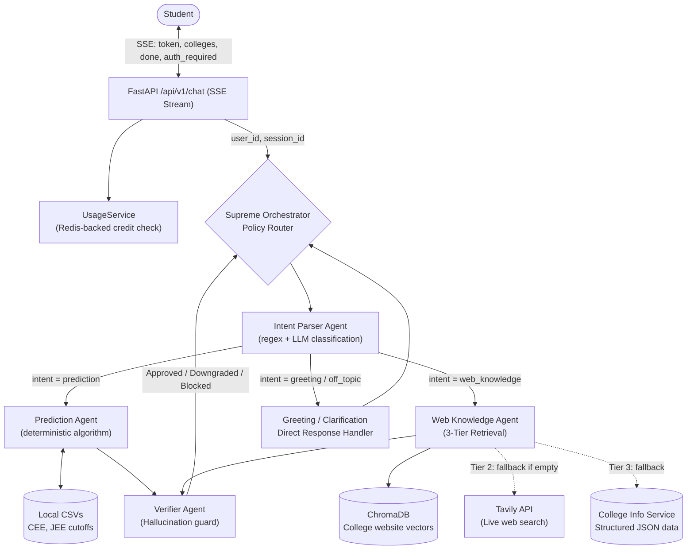

# HiRank (RankRoute)

HiRank is an AI-powered college admission counseling platform. It leverages an intelligent backend system connected to vector databases, live statistics, and LLMs to provide students with personalized predictions and guidance for entrance exams (JEE Main, JEE Advanced, NEET, CEE). 

The platform features a modern, responsive web interface, a robust FastAPI backend, intelligent data ingestion pipelines, and comprehensive administrative analytics.

## 🚀 Key Features

* **AI-Powered Admissions Counselor:** Context-aware RAG pipeline powered by LangChain and Hugging Face Embeddings for dynamic Q&A about colleges, cutoffs, and admissions processes.
* **Intelligent Rank Prediction:** The `CutoffEngine` analyzes real-world historical CSV data to filter and predict feasible colleges based on a student's rank, percentile, category, and target exams.
* **Automated Data Ingestion:** Includes web scraping pipelines, subpage discovery, vector store chunking (ChromaDB), and page cleaners to keep the AI's knowledge base continuously up-to-date.
* **Administrative Analytics:** Comprehensive admin dashboards for observing chat logs, API usage, active user counts, and system health.
* **Profile Enrichment:** Automatically extracts structured data (exam type, rank, category) from conversational text to build implicit user profiles.
* **Modern Security:** Built-in rate limiting (Redis), CSP headers, and robust Supabase authentication (Magic Links, OTP, OAuth).
* **Enterprise Infrastructure:** Fully automated CI/CD to Azure Container Apps utilizing Azure Key Vault and Managed Identities.

## 💻 Tech Stack

### Frontend
* **Framework:** Next.js (App Router), React 18
* **Language:** TypeScript
* **Styling:** Tailwind CSS
* **API Client:** Native `fetch` configured for `/api/v1` routes
* **State & Context:** React Context API

### Backend
* **Framework:** FastAPI (Python 3.11)
* **AI & Embeddings:** LangChain, HuggingFace Inference Endpoints (`HuggingFaceEndpointEmbeddings`)
* **Vector Store:** ChromaDB
* **Database:** Supabase (PostgreSQL), Redis (Rate Limiting & Caching)
* **Testing:** Pytest, Pytest-Asyncio

### Infrastructure
* **Deployment:** Azure Container Apps (ACA), Azure Key Vault
* **CI/CD:** GitHub Actions (lint, test, build, deploy)
* **Containerization:** Docker

---

## 🏗️ Architecture

### High-Level System Design

```
┌─────────────────────────────────────────────────────────────────────┐
│                         CLIENT (Browser)                           │
│  ┌─────────────┐  ┌──────────────┐  ┌───────────────────────────┐ │
│  │  Next.js 15  │  │  AuthProvider│  │  useChats (Hook)          │ │
│  │  React 19    │  │  (Supabase)  │  │  SSE Streaming           │ │
│  │  Tailwind 4  │  │  httpOnly    │  │  Optimistic Updates      │ │
│  └──────┬───────┘  │  Cookies     │  └───────────┬───────────────┘ │
│         │          └──────┬───────┘              │                 │
└─────────┼─────────────────┼──────────────────────┼─────────────────┘
          │                 │                      │
     HTTPS:9000        Credentials:          SSE Events:
          │             'include'            token, colleges,
          │                                  done, auth_required
          ▼                 ▼                      ▼
┌─────────────────────────────────────────────────────────────────────┐
│                     GUNICORN + UVICORN (4 workers)                  │
│                         FastAPI Application                         │
│                                                                     │
│  ┌──────────────────────────────────────────────────────────────┐  │
│  │                    MIDDLEWARE STACK                           │  │
│  │  CORS · RequestCtx · RateLimit · Tracing · ExceptionHandler  │  │
│  └──────────────────────────────────────────────────────────────┘  │
│                                                                     │
│  ┌──────────────────────────────────────────────────────────────┐  │
│  │              SUPREME ORCHESTRATOR                             │  │
│  │  Intent Parser → Prediction Agent / Web Knowledge Agent      │  │
│  │                  → Verifier Agent → SSE Stream                │  │
│  └──────────────────────────────────────────────────────────────┘  │
└──────────────────────────┬──────────────────────────────────────────┘
                           │
            ┌──────────────┼──────────────────┬──────────────────┐
            ▼              ▼                  ▼                  ▼
┌─────────────────┐ ┌──────────┐ ┌──────────────────┐ ┌──────────────┐
│   Supabase DB   │ │ ChromaDB │ │      Redis       │ │  Local CSVs  │
│  (PostgreSQL)   │ │ (Vector) │ │ • Celery broker  │ │  (CEE, JEE)  │
│  • Profiles     │ │ • College│ │ • Usage counters │ │  • Cutoffs   │
│  • Chats        │ │   website│ │ • Rate limit     │ │  • Rank data │
│  • Messages     │ │   chunks │ │ • OTP metadata   │ │              │
└─────────────────┘ └──────────┘ └──────────────────┘ └──────────────┘
                           │
                           ▼
┌─────────────────────────────────────────────────────────────────────┐
│                   CELERY WORKER (Background)                        │
│  Ingestion Queue · Admin Alerts · Celery Beat (Weekly Rescrape)    │
└─────────────────────────────────────────────────────────────────────┘
```

### Data Layer

| Store | Technology | Purpose |
|-------|-----------|---------|
| **Relational DB** | Supabase (PostgreSQL) | User profiles, chat history, anonymous sessions. RLS policies enforce data isolation. |
| **Vector DB** | ChromaDB (persistent) | Dense vector embeddings of scraped college websites. Version-tagged to prevent staleness. |
| **Cache & Counters** | Redis | Celery broker, usage counters (atomic Lua scripts), rate limiting, OTP metadata, URL dedup. |
| **Structured Data** | Local CSV files | Deterministic rank prediction — `cee_cutoffs.csv`, `jee_cutoffs.csv`. Read at query time, never embedded. |

---

### AI Multi-Agent Architecture

The system uses a **Policy-Driven Multi-Agent Orchestrator**. Queries are routed intelligently through specialized agents, each with strict boundaries.



#### Request Flow

1. **SSE Connection**: Frontend opens a POST to `/api/v1/chat` with `Accept: text/event-stream`. Backend streams tokens via Server-Sent Events.
2. **Auth & Quota Gate** (`usage_service.py`): Checks atomic Redis counters. Anonymous users get 3 prompts; authenticated users get unlimited prompts with 5 Tavily searches/month. Fail-open if Redis is unreachable.
3. **Supreme Orchestrator** (`orchestrator.py`): Delegates to Intent Parser, routes to the appropriate agent.
4. **Intent Parser** (`intent_agent.py`): Classifies query into `greeting`, `prediction`, `web_knowledge`, `off_topic`, or `clarification` via regex + LLM fallback.
5. **Specialized Agents**:
   - **Prediction Agent**: Deterministic algorithms against CSV cutoff data. No LLM involved.
   - **Web Knowledge Agent (3-Tier)**: Tier 1 = ChromaDB with freshness scoring → Tier 2 = Tavily live web search (restricted to `.ac.in`, `.edu.in`) → Tier 3 = Local structured data.
6. **Verifier Agent**: Hallucination guard. Ensures rank claims are backed by CSV evidence. Can downgrade or block responses.
7. **Self-Healing**: When Tavily discovers a new official URL, a Celery task permanently ingests it into ChromaDB with version-tagging.

#### Policy Engine

| Policy | File | Responsibility |
|--------|------|---------------|
| Routing | `routing_policy.py` | Maps intent → agent |
| Budget | `budget_policy.py` | Controls per-request token/API spend |
| Source | `source_policy.py` | Approves/denies data sources by trust tier |
| Retrieval | `retrieval_policy.py` | Configures ChromaDB query parameters |
| Verification | `verification_policy.py` | Sets verifier strictness per intent |
| Fallback | `fallback_policy.py` | Controls Tavily/local fallback triggers |

---

### Frontend Architecture

```
frontend/
├── app/
│   ├── layout.tsx          # Root layout: AuthProvider + Toaster
│   ├── page.tsx            # Entry: auth gate → LandingAuth or ApplicationLayout
│   └── globals.css         # Tailwind imports + custom scrollbar
├── components/
│   ├── application-layout.tsx   # Shell: sidebar + chat area orchestration
│   ├── chat-area.tsx            # SSE stream, message display, input
│   ├── sidebar.tsx              # Chat list with date grouping via useMemo
│   ├── landing-auth.tsx         # 3-step auth: email → OTP → onboarding
│   ├── settings-modal.tsx       # Profile editing, sign out, guest CTA
│   └── typewriter-greeting.tsx  # Animated cycling greeting text
├── hooks/
│   ├── use-chats.ts        # Chat lifecycle: CRUD + anon sessions
│   └── use-mobile.ts       # Responsive breakpoint detection
├── lib/
│   ├── auth-context.tsx    # AuthProvider + useAuth() hook
│   ├── api.ts              # Centralized fetchApi() wrapper
│   ├── types.ts            # TypeScript interfaces matching backend
│   └── utils.ts            # cn() tailwind-merge utility
└── middleware.ts           # Pass-through (auth enforced server-side)
```

#### Key Design Decisions

| Decision | Rationale |
|----------|-----------|
| **No client-side auth SDK** | All auth flows through backend API with `httpOnly` cookies. Zero Supabase/Clerk keys exposed to the browser. |
| **Derived message state** | `displayMessages` is a `useMemo` over `messages` prop + `streamingMessages` overlay. Eliminates stale closure bugs. |
| **SSE with fetch-event-source** | `@microsoft/fetch-event-source` handles reconnection, event parsing, and cancellation. |
| **FingerprintJS for guest IDs** | Resilient, incognito-proof visitor tracking for anonymous session persistence. |

#### SSE Protocol

| Event Type | Payload | Frontend Action |
|------------|---------|-----------------|
| `token` | `{"type":"token","data":"text"}` | Append to streaming message |
| `colleges` | `{"type":"colleges","data":[...]}` | Store prediction metadata |
| `done` | `{"type":"done","tavily_skipped":true}` | Signal stream end |
| `auth_required` | `{"type":"auth_required"}` | Show login toast |
| `error` | `{"type":"error","data":"msg"}` | Log error, show toast |

---

### Authentication System

All auth is built on Supabase Auth with no third-party frontend SDKs.

| Method | Endpoint | Flow |
|--------|----------|------|
| **Email OTP** | `POST /api/v1/auth/email/send-otp` | Send email → 6-digit code → `POST /api/v1/auth/email/verify` |
| **Google OAuth** | `GET /api/v1/auth/google` | Redirect → Supabase consent → callback sets `httpOnly` cookies |
| **Session** | `GET /api/v1/auth/session` | Returns authenticated user from cookie |
| **Logout** | `POST /api/v1/auth/logout` | Clears `httpOnly` cookies |

| Security Property | Implementation |
|-------------------|---------------|
| Token storage | `httpOnly` cookies — not accessible via JavaScript |
| Cookie security | `Secure` flag enabled in production |
| CSRF protection | `SameSite=Lax` on all cookies |
| Email validation | `EmailValidator` blocks disposable domains, strips Gmail aliases |
| Profile enrichment | Passive NLP extraction from chat messages (Celery task) |

---

### Freemium Gate & Usage Enforcement

Usage is enforced via **atomic Redis Lua scripts** to prevent race conditions.

| User Type | Prompts | Tavily Searches | Reset |
|-----------|---------|-----------------|-------|
| Anonymous (guest) | 3 total | 1 total | Never (until login) |
| Authenticated | Unlimited | 5 per month | Auto-resets 1st of month |

Admin alerts fire at 50% and 90% of the global Tavily monthly quota, plus a daily digest email.

---

### Freshness & Staleness Strategy

ChromaDB chunks are version-tagged. Freshness is computed **dynamically at query time**, not stored in metadata.

| Bucket | Age | Score Multiplier |
|--------|-----|-----------------|
| `current` | <30 days | 1.0 |
| `recent` | <90 days | 0.9 |
| `stale` | <180 days | 0.7 |
| `archive` | ≥180 days | 0.5 |
| `unknown` | No date | 0.6 |

`adjusted_score = relevance_score × freshness_multiplier`

---

### Observability & Fail-Open Design

| Dependency Failure | System Behavior |
|-------------------|-----------------|
| **Redis unreachable** | Usage gate allows all requests (counters bypassed). |
| **Tavily API down** | Falls to Tier 3 (local data). LLM hedges: "Live search unavailable." |
| **ChromaDB empty** | Falls to Tier 2 (Tavily) then Tier 3 (local data). |
| **Supabase offline** | Chat SSE streaming still works (anonymous path). |

---

## 📂 Repository Structure

```text
rankroute/
├── backend/                  # FastAPI backend server
│   ├── app/                  # Application code
│   │   ├── api/              # API Endpoints (v1)
│   │   ├── core/             # LLM configurations & embeddings
│   │   ├── db/               # Supabase and migrations
│   │   ├── ingestion/        # Web scraping & vector ingestion pipeline
│   │   ├── middleware/       # Rate limiting, Auth, CSP
│   │   ├── models/           # Pydantic schemas
│   │   ├── orchestration/    # Agent-based AI routing policies
│   │   ├── retrieval/        # Cutoff engine & metadata filters
│   │   └── services/         # Core business logic
│   ├── tests/                # Pytest suite
│   ├── scripts/              # Utility scripts
│   ├── Dockerfile            # Backend container image
│   ├── requirements.txt      # Production dependencies
│   └── requirements-lock.txt # Pinned lockfile for CI
├── frontend/                 # Next.js frontend application
│   ├── app/                  # Next.js App Router (pages & layouts)
│   ├── components/           # Reusable React components
│   ├── hooks/                # Custom React hooks
│   ├── lib/                  # Utilities and API clients
│   └── package.json          # Node dependencies
├── infrastructure/           # Cloud deployment files
│   └── azure/                # Shell scripts for Azure ACA & Key Vault
├── .github/                  # GitHub Actions CI/CD workflows
└── docs/                     # ER diagrams and design mockups
```

## 🔌 API Reference

### Chat & Streaming

| Method | Endpoint | Auth | Purpose |
|--------|----------|------|---------|
| `POST` | `/api/v1/chat` | Optional (cookie) | SSE-streamed chat response |

### Authentication

| Method | Endpoint | Auth | Purpose |
|--------|----------|------|---------|
| `GET` | `/api/v1/auth/session` | Cookie | Returns current user session |
| `POST` | `/api/v1/auth/logout` | Cookie | Clears auth cookies |
| `POST` | `/api/v1/auth/email/send-otp` | None | Send email OTP |
| `POST` | `/api/v1/auth/email/verify` | None | Verify OTP, set cookies |
| `GET` | `/api/v1/auth/google` | None | Redirect to Google OAuth |
| `GET` | `/api/v1/auth/callback` | None | OAuth callback handler |
| `POST` | `/api/v1/auth/refresh` | Cookie | Refresh access token |

### Chats (Authenticated)

| Method | Endpoint | Auth | Purpose |
|--------|----------|------|---------|
| `GET` | `/api/v1/chats` | Cookie | List user's chats |
| `POST` | `/api/v1/chats` | Cookie | Create new chat |
| `GET` | `/api/v1/chats/{id}` | Cookie | Get chat with messages |
| `PATCH` | `/api/v1/chats/{id}` | Cookie | Rename chat |
| `DELETE` | `/api/v1/chats/{id}` | Cookie | Delete chat + messages |
| `POST` | `/api/v1/chats/clear` | Cookie | Delete all chats for user |

### Temp Chats (Anonymous)

| Method | Endpoint | Auth | Purpose |
|--------|----------|------|---------|
| `GET` | `/api/v1/temp-chats/{session_id}` | None | Get temp chat by session |
| `POST` | `/api/v1/transfer-temp-chat` | Cookie | Transfer anon chat to auth user |

### Messages

| Method | Endpoint | Auth | Purpose |
|--------|----------|------|---------|
| `POST` | `/api/v1/messages` | Cookie | Save a message |

### Profile

| Method | Endpoint | Auth | Purpose |
|--------|----------|------|---------|
| `GET` | `/api/v1/profile` | Cookie | Get user profile |
| `PATCH` | `/api/v1/profile` | Cookie | Update profile fields |

### Other

| Method | Endpoint | Auth | Purpose |
|--------|----------|------|---------|
| `GET` | `/api/v1/health` | None | Health check (ChromaDB, cache, policies) |
| `POST` | `/api/v1/scrape/run` | API key | Trigger ingestion job |
| `GET` | `/api/v1/scrape/status/{job_id}` | API key | Check ingestion status |
| `GET` | `/api/v1/colleges` | None | Look up college data by rank |

### Entity-Relationship Diagram

See [`docs/ER_DIAGRAM.md`](docs/ER_DIAGRAM.md) for the full Mermaid ERD, schema design decisions, and RLS policies.

---

## 🛠️ Getting Started

### Prerequisites
* Python 3.11+
* Node.js 18+
* Redis (local or remote)
* Supabase Account

### 1. Backend Setup
```bash
cd backend
python -m venv venv
source venv/bin/activate  # Or `venv\Scripts\activate` on Windows

# Install dependencies
pip install -r requirements.txt

# Run the server
uvicorn app.main:app --reload --port 9000
```

### 2. Frontend Setup
```bash
cd frontend
npm install

# Run the development server
npm run dev
```

### 3. Environment Variables
Create a `.env` file in the `backend/` directory. See `.env.example` for the required keys.

| Variable | Required | Description |
|----------|----------|-------------|
| `SUPABASE_URL` | Yes | Supabase project URL |
| `SUPABASE_SERVICE_KEY` | Yes | Supabase service role key |
| `SUPABASE_JWT_SECRET` | Yes | JWT secret for token verification |
| `GROQ_API_KEY` | Yes | LLM inference via Groq |
| `HUGGINGFACE_API_TOKEN` | Yes | Embedding API |
| `TAVILY_API_KEY` | Yes | Live web search fallback |
| `REDIS_URL` | Yes | Redis connection for Celery, caching, rate limiting |
| `FRONTEND_URL` | No | CORS + OAuth redirect (default: `http://localhost:3000`) |

## 🧪 Testing

The backend includes a comprehensive test suite covering security, remediation, vector stores, and rate limits.
```bash
cd backend
pytest tests/ -v
```

## 🚀 Deployment
Deployment is fully automated via GitHub Actions (`.github/workflows/deploy-azure.yml`).
Pushing to the `main` branch will:
1. Run linting and unit tests (`ci.yml`).
2. Build the Docker container for the backend.
3. Run database migrations via `psql` against Supabase.
4. Provision/Update Azure Key Vault and Managed Identities (`infrastructure/azure/deploy.sh`).
5. Deploy the latest image to Azure Container Apps.