# RankRoute — Complete Entity-Relationship Diagram

```mermaid
erDiagram
    %% ====================================================================
    %% SUPABASE (PostgreSQL) — Primary Relational Store
    %% ====================================================================
    
    auth_users {
        uuid id PK
        string email
        jsonb raw_user_meta_data
        timestamp created_at
    }
    
    profiles {
        uuid id PK,FK
        string email UK
        string phone UK
        string name
        string avatar_url
        string role "user|admin|moderator"
        boolean onboarding_complete
        string exam "JEE_MAIN|JEE_ADV|NEET|CEE|OTHER"
        integer rank
        numeric percentile "5,2"
        string category "General|OBC|SC|ST|EWS"
        string home_state
        textArray branch_preferences
        string whatsapp_number
        string fingerprint_id
        timestamp created_at
        timestamp updated_at
    }
    
    chats {
        uuid id PK
        uuid user_id FK
        string title
        timestamp created_at
        timestamp updated_at
    }
    
    messages {
        uuid id PK
        uuid chat_id FK
        string role "user|assistant|system"
        text content
        jsonb metadata
        timestamp created_at
    }
    
    temp_chats {
        uuid id PK
        string session_id UK
        string title
        timestamp created_at
        timestamp updated_at
    }
    
    temp_messages {
        uuid id PK
        string session_id FK
        string role "user|assistant|system"
        text content
        jsonb metadata
        timestamp created_at
    }
    
    admin_logs {
        uuid id PK
        string event_type
        string severity "info|warning|error|critical"
        string actor_id
        string actor_role
        string summary
        jsonb details
        string source
        timestamp created_at
    }

    %% ====================================================================
    %% CHROMADB — Vector Database (Semantic Search)
    %% 3 collections, each with a different metadata schema
    %% ====================================================================
    
    chroma_college_web_docs {
        string id PK "SHA-256(URL+content_hash+index)[:24]"
        text document "Raw text content"
        vector embedding "384d Float32 (all-MiniLM-L6-v2)"
        string college_name
        string page_type "fees|placement|hostel|admission|notice|general"
        string source_url
        string scraped_at "ISO timestamp"
        string content_hash
        boolean is_official
        string domain
        string document_title
        integer chunk_index
        string scrape_version
        string validation_status "passed|downgraded|validator_error"
    }
    
    chroma_cee {
        string id PK "UUID5(org+branch+cat+year+round)"
        text document "CEE cutoff as prose"
        vector embedding "384d Float32"
        string college_name
        string college_code
        string branch
        string category
        integer opening_rank
        integer closing_rank
        integer year
        string seat_type
        string source "CEE"
    }
    
    chroma_jee {
        string id PK "UUID5(org+branch+cat+quota+year)"
        text document "JEE cutoff as prose"
        vector embedding "384d Float32"
        string institute_name
        string college_name
        string branch
        string category
        integer opening_rank
        integer closing_rank
        integer year
        string quota "Home State|Other State|AI"
        string seat_type
        string source "JEE"
    }

    %% ====================================================================
    %% REDIS — In-Memory Cache & Broker (7 key patterns across 2 files)
    %% ====================================================================
    
    redis_usage_anon_prompts {
        string key "anon:prompts:{session_id}"
        integer count "atomic INCR"
        integer ttl "7 days"
    }
    
    redis_usage_anon_tavily {
        string key "anon:tavily:{session_id}"
        integer count "atomic INCR"
        integer ttl "30 days"
    }
    
    redis_usage_auth_tavily {
        string key "auth:tavily:{user_id}:{YYYY-MM}"
        integer count "atomic INCR"
        integer ttl "35 days"
    }
    
    redis_usage_global_tavily {
        string key "tavily:global:{YYYY-MM}"
        integer count "atomic INCR"
        integer ttl "35 days"
    }
    
    redis_usage_alert_sent {
        string key "tavily:alert:sent:{YYYY-MM}:{pct}"
        boolean sent "setnx — 50pct and 90pct thresholds"
        integer ttl "35 days"
    }
    
    redis_ingested_urls {
        string key "rankroute:ingested_urls"
        set urls "SADD membership check for dedup"
        integer ttl "7 days"
    }
    
    redis_celery_broker {
        string queues "ingestion (default)"
        string result_backend "task async results"
        string note "Managed by Celery library — no explicit key patterns in app code"
    }

    %% ====================================================================
    %% IN-MEMORY CACHE (NOT Redis)
    %% ====================================================================
    
    inmem_cache {
        string namespace "intent|prediction|web_summary|answer"
        string key "SHA256-hashed[:24]"
        any value
        float ttl_seconds "300|600|1800|120 per namespace"
        integer max_entries "500 per namespace"
    }

    %% ====================================================================
    %% FILESYSTEM DATA — CSV/JSON Structured Data
    %% ====================================================================
    
    file_cee_cutoffs {
        string path "./data/cee_cutoffs.csv"
        string columns "college,branch,category,opening_rank,closing_rank,year,seat_type"
        string rows "~575"
    }
    
    file_jee_cutoffs {
        string path "./data/jee_cutoffs.csv"
        string columns "institute,branch,category,opening_rank,closing_rank,year,quota,seat_type"
        string rows "~320"
    }
    
    file_college_info {
        string path "./data/college_info/"
        string csvs "colleges_basic_info.csv, fee_structure.csv, placement_stats.csv, facilities.csv, seat_matrix.csv"
        string jsons "branch_details.json, admission_processes.json"
    }

    %% ====================================================================
    %% EXTERNAL APIs
    %% ====================================================================
    
    supabase_auth {
        string service "Auth REST API"
        string endpoint_otp "POST /auth/v1/otp (send email OTP)"
        string endpoint_verify "POST /auth/v1/token?grant_type=email_otp (verify)"
        string endpoint_user "GET /auth/v1/user (get session)"
        string endpoint_logout "GET /auth/v1/logout (clear session)"
    }
    
    groq_llm {
        string service "Groq Cloud API"
        string primary_model "llama-3.3-70b-versatile (primary)"
        string fallback_model "llama-3.1-8b-instant (fallback)"
    }
    
    tavily_search {
        string service "Tavily Search API"
        string quota "1000 searches/month (free tier)"
        integer max_results "5 (configurable)"
    }

    %% ====================================================================
    %% RELATIONSHIPS
    %% ====================================================================
    
    %% --- PostgreSQL Relationships ---
    auth_users ||--o| profiles : "ON DELETE CASCADE (handle_new_user trigger)"
    profiles ||--o{ chats : "user_id REFERENCES profiles(id) ON DELETE CASCADE"
    chats ||--o{ messages : "chat_id REFERENCES chats(id) ON DELETE CASCADE"
    temp_chats ||--o{ temp_messages : "session_id REFERENCES temp_chats(session_id) ON DELETE CASCADE"
    
    %% --- Cross-Store Relationships ---
    profiles ||--o{ redis_usage_auth_tavily : "user_id → key suffix (auth tracking)"
    temp_chats ||--o{ redis_usage_anon_prompts : "session_id → key suffix (anon tracking)"
    temp_chats ||--o{ redis_usage_anon_tavily : "session_id → key suffix (anon tracking)"
    
    chroma_college_web_docs ||--o{ redis_ingested_urls : "source_url → set member (dedup)"
    
    file_cee_cutoffs ||--o{ chroma_cee : "ingested into vector collection"
    file_cee_cutoffs ||--o{ chroma_jee : "JEE data from separate CSV"
    file_jee_cutoffs ||--o{ chroma_jee : "ingested into vector collection"
    file_college_info ||--o{ profiles : "used for personalized recommendations"
    
    %% --- Service-to-Data Relationships ---
    supabase_auth ||--o{ profiles : "creates on signup (handle_new_user trigger)"
    supabase_auth ||--o{ chats : "owns via JWT identity"
    supabase_auth ||--o{ temp_chats : "no auth (session_id only, no FK)"
    
    groq_llm ||--o{ messages : "generates assistant response tokens"
    groq_llm ||--o{ chroma_college_web_docs : "reads chunks as RAG context"
    
    tavily_search ||--o{ redis_usage_global_tavily : "increments on each search call"
    tavily_search ||--o{ chroma_college_web_docs : "self-heal: queues discovered URLs for ingestion"
    
    redis_celery_broker ||--o{ chroma_college_web_docs : "dispatches ingestion tasks"
    redis_celery_broker ||--o{ admin_logs : "dispatches alert logging"
    
    inmem_cache ||--o{ messages : "caches parsed intents & predictions"
    inmem_cache ||--o{ chroma_college_web_docs : "caches college web summaries"
```



---

## Data Flow & Entity Ownership

### 1. PostgreSQL (Supabase) — Relational Core

```
┌──────────────────────────────────────────────────────────────────────┐
│                         SUPABASE / POSTGRESQL                        │
│                                                                      │
│  auth.users ──1:1──▶ profiles ──1:N──▶ chats ──1:N──▶ messages     │
│       │                                                              │
│       │                    temp_chats ──1:N──▶ temp_messages         │
│       │                                                              │
│       └── (handle_new_user trigger auto-creates profile)            │
│                                                                      │
│  admin_logs (standalone — accessed via service_role key, no RLS)     │
└──────────────────────────────────────────────────────────────────────┘
```

**Ownership & Access:**
| Table | Auth Method | RLS Policy |
|-------|-------------|------------|
| `profiles` | JWT cookie | `auth.uid() = id` (own profile only) |
| `chats` | JWT cookie | `auth.uid() = user_id` |
| `messages` | JWT cookie | `EXISTS(chat WHERE user_id = auth.uid())` |
| `temp_chats` | `session_id` header | `ALL true` (no auth) |
| `temp_messages` | `session_id` header | `ALL true` (no auth) |
| `admin_logs` | service_role key | No RLS (backend-only access) |

**Entity Details:**
| Entity | PK Strategy | FK Cascade | Row-Level Security |
|--------|-------------|------------|--------------------|
| `profiles` | UUID (from `auth.users.id`) | `ON DELETE CASCADE` from `auth.users` | Users see own profile only |
| `chats` | `uuid_generate_v4()` | `profiles(id) ON DELETE CASCADE` | Users see own chats only |
| `messages` | `uuid_generate_v4()` | `chats(id) ON DELETE CASCADE` | Via parent chat ownership |
| `temp_chats` | `uuid_generate_v4()` | none (session_id is app-generated) | Public (ALL true) |
| `temp_messages` | `uuid_generate_v4()` | `temp_chats(session_id) ON DELETE CASCADE` | Public (ALL true) |
| `admin_logs` | `gen_random_uuid()` | none (service_role only) | No RLS |

---

### 2. ChromaDB — Vector Store (3 Collections)

```
┌──────────────────────────────────────────────────────────────────────┐
│                  CHROMADB (./data/chroma/)                           │
│                                                                      │
│  ┌────────────────────────┐  ┌────────────┐  ┌────────────┐         │
│  │ college_web_docs       │  │ cee        │  │ jee        │         │
│  │                        │  │            │  │            │         │
│  │ Web content chunks     │  │ CEE cutoff │  │ JEE cutoff │         │
│  │ from scraped college   │  │ rows as    │  │ rows as    │         │
│  │ pages. Indexed at      │  │ structured │  │ structured │         │
│  │ ingestion time.        │  │ prose.     │  │ prose.     │         │
│  │ Searched by:           │  │ N=~575.    │  │ N=~320.    │         │
│  │ web_knowledge_agent    │  │ Searched   │  │ Searched   │         │
│  │                        │  │ by:        │  │ by:        │         │
│  │ ID: SHA256 hex[:24]   │  │ chroma_cl  │  │ chroma_cl  │         │
│  │ Metadata: 11 fields    │  │ ient       │  │ ient       │         │
│  │ Embedding: 384d cosine │  │ (legacy)   │  │ (legacy)   │         │
│  └────────────────────────┘  └────────────┘  └────────────┘         │
│                                                                      │
│  Embedding Model: sentence-transformers/all-MiniLM-L6-v2 (384d)     │
│  Distance Metric: cosine                                            │
│  Client: chromadb.PersistentClient (singleton)                      │
└──────────────────────────────────────────────────────────────────────┘
```

**Collection Lifecycle:**
| Collection | Created By | Written By | Read By | Record Count |
|-----------|-----------|-----------|---------|-------------|
| `college_web_docs` | `upsert_service.py` | Celery ingestion tasks | `web_knowledge_agent.py` | ~18 |
| `cee` | `chroma_client.py` init | `DataIngestor`, admin upload | `chroma_client.py` search | ~575 |
| `jee` | `chroma_client.py` init | `DataIngestor`, admin upload | `chroma_client.py` search | ~320 |

---

### 3. Redis — Usage Tracking & Celery Broker (7 Key Patterns)

```
┌──────────────────────────────────────────────────────────────────────┐
│                              REDIS                                   │
│                                                                      │
│  ┌─────────────────────┐  ┌──────────────────────┐                  │
│  │ USAGE COUNTERS      │  │ CELERY BROKER        │                  │
│  │ (usage_service.py)  │  │ (worker.py)          │                  │
│  │                     │  │                      │                  │
│  │ anon:prompts:{sid}  │  │ Queue: ingestion     │                  │
│  │   TTL 7d            │  │ Result Backend       │                  │
│  │ anon:tavily:{sid}   │  │                      │                  │
│  │   TTL 30d           │  │ DEDUP SET            │                  │
│  │ auth:tavily:{uid}:  │  │ (upsert_service.py)  │                  │
│  │   {YYYY-MM} TTL 35d │  │                      │                  │
│  │ tavily:global:      │  │ rankroute:           │                  │
│  │   {YYYY-MM} TTL 35d │  │   ingested_urls      │                  │
│  │ tavily:alert:sent:  │  │   TTL 7d             │                  │
│  │   {YYYY-MM}:50pct   │  │                      │                  │
│  │   {YYYY-MM}:90pct   │  │                      │                  │
│  │   TTL 35d           │  │                      │                  │
│  └─────────────────────┘  └──────────────────────┘                  │
│                                                                      │
│  Atomicity: All usage increments use a single Lua script             │
│  (INCR → check limit → DECR if exceeded → return {allowed,remaining})│
│  Connection: Lazy-init via redis.from_url(settings.redis_url)        │
└──────────────────────────────────────────────────────────────────────┘
```

---

### 4. In-Memory Cache (Not Redis)

```
┌──────────────────────────────────────────────────────────────────────┐
│              IN-MEMORY CACHE (cache_service.py)                      │
│                                                                      │
│  CacheService (Dict[str, Dict[str, CacheEntry]])                     │
│                                                                      │
│  ┌──────────┐  ┌────────────┐  ┌─────────────┐  ┌──────────┐       │
│  │ intent   │  │ prediction │  │ web_summary │  │ answer   │       │
│  │ TTL:5min │  │ TTL:10min  │  │ TTL:30min   │  │ TTL:2min │       │
│  │ Max:500  │  │ Max:500    │  │ Max:500      │  │ Max:500  │       │
│  └──────────┘  └────────────┘  └─────────────┘  └──────────┘       │
│                                                                      │
│  Key: SHA256(normalized_parts)[:24]                                  │
│  Eviction: LRU when namespace exceeds 500 entries                   │
│  Singleton: cache_service (imported by orchestrator.py)             │
└──────────────────────────────────────────────────────────────────────┘
```

---

### 5. Filesystem — Structured College Data

```
┌──────────────────────────────────────────────────────────────────────┐
│            FILESYSTEM (./data/ — loaded at startup)                   │
│                                                                      │
│  ┌────────────────────────────────────────────────────────────────┐  │
│  │                 CutoffEngine loads:                             │  │
│  │  ./data/cee_cutoffs.csv      ~575 rows  (settings.cee_data_path)│  │
│  │  ./data/jee_cutoffs.csv      ~320 rows  (settings.jee_data_path)│  │
│  └────────────────────────────────────────────────────────────────┘  │
│                                                                      │
│  ┌────────────────────────────────────────────────────────────────┐  │
│  │                 CollegeInfoService loads:                       │  │
│  │  ./data/college_info/                                          │  │
│  │  ├── colleges_basic_info.csv   (name, code, location, website) │  │
│  │  ├── fee_structure.csv         (college, branch, fees, year)   │  │
│  │  ├── placement_stats.csv       (college, branch, avg_package,  │  │
│  │  │                              placement_rate, year)           │  │
│  │  ├── facilities.csv            (college, facility_type, desc)  │  │
│  │  ├── seat_matrix.csv           (college, branch, category,     │  │
│  │  │                              seats, year)                    │  │
│  │  ├── branch_details.json       (branch metadata, duration)     │  │
│  │  └── admission_processes.json  (exam procedures, timelines)    │  │
│  └────────────────────────────────────────────────────────────────┘  │
│                                                                      │
│  Hot-Reload: Admin upload endpoints trigger reload_all() / reload()  │
│  Backup: Auto-backup to ./data/backups/ before every overwrite      │
└──────────────────────────────────────────────────────────────────────┘
```

---

### 6. End-to-End Chat Flow (Entity Interaction)

```
User Message
    │
    ▼
POST /api/chat ──▶ UsageService.check_and_increment_anon/auth()
    │                  │
    │                  ▼
    │              Redis (usage counters — atomic Lua script)
    │
    ▼
IntentAgent ──▶ RequestFrame {intent, exam, rank, category, ...}
    │
    ├── "prediction" intent ──▶ CutoffEngine (deterministic, no LLM)
    │                              │
    │                              ├── file_cee_cutoffs.csv
    │                              └── file_jee_cutoffs.csv
    │                              │
    │                              ▼
    │                          CutoffRecord[]
    │                              │
    │                              ▼
    │                          PredictionAgent (LLM formats output)
    │                              │
    │                              ▼
    │                          PredictionOption{safe/target/ambitious}
    │
    ├── "college_info" intent ──▶ WebKnowledgeAgent
    │                              │
    │                              ├── ChromaDB ──▶ college_web_docs
    │                              │                   (semantic search)
    │                              │
    │                              ├── Tavily Search API ──▶ Redis
    │                              │   (credit check via usage counters)
    │                              │   (self-heal: queue URLs → Celery)
    │                              │
    │                              └── CollegeInfoService
    │                                  └── file_college_info/
    │
    └── ALL intents pass through:
            │
            ▼
        VerifierAgent (checks contradictions, missing fields)
            │
            ▼
        Groq LLM ──▶ SSE stream of tokens → messages table (Supabase)
            │
            ▼
        ProfileEnricher (Celery background task)
            └── Extracts exam/rank/category from chat text
            └── Updates profiles table
```

---

### 7. Ingestion Pipeline (Write Path)

```
Weekly Cron / Self-Heal Discovery
    │
    ▼
Celery Task: discover_and_ingest_job
    │
    ├── Step 1: subpage_discovery.py
    │   ├── httpx.AsyncClient → fetch homepage HTML
    │   ├── LinkParser (stdlib html.parser) → extract <a href>
    │   ├── Same-domain filter (urllib.parse)
    │   └── Keyword relevance filter (50+ keywords, 14+ exclude)
    │
    └── Step 2: _async_ingestion.py (per URL)
        ├── fetch_page(url)        httpx (retry 3x via tenacity)
        ├── clean_page(html)       Trafilatura.extract()
        ├── validate_page()        ContentValidator
        │   ├── validate_title()     → reject if error page pattern
        │   ├── validate_symbol()    → reject if >40% non-alphanumeric
        │   ├── validate_type()      → downgrade if missing expected data
        │   └── thin content gate    → reject if <30 words (general)
        ├── chunk_text(text)       Section-aware chunker (512 token target)
        ├── embed_chunks(texts)    EmbeddingService (batch_size=32)
        └── upsert_chunks()        ChromaDB (batch_size=50)
            └──→ Redis SADD rankroute:ingested_urls (7d TTL for dedup)

Admin CSV Upload
    │
    ▼
POST /api/admin/upload/cutoffs
    ├── _validate_cutoff_csv()     Column rename + type check + preview
    ├── _save_with_backup()        Copy current → ./data/backups/{ts}__{file}
    ├── cuttoff_engine.reload()    Re-read CSV → atomic DataFrame swap
    └── DataIngestor.ingest_from_path()  → ChromaDB (purge + re-ingest cee/jee)
```

---

### 8. Cross-Store Relationship Summary

| From | To | Type | Mechanism | Direction |
|------|----|------|-----------|-----------|
| `auth.users` | `profiles` | 1:1 | DB trigger `handle_new_user` | C |
| `profiles` | `chats` | 1:N | FK `user_id` | C |
| `chats` | `messages` | 1:N | FK `chat_id` ON DELETE CASCADE | C |
| `temp_chats` | `temp_messages` | 1:N | FK `session_id` ON DELETE CASCADE | C |
| `file_cee_cutoffs` | `chroma_cee` | 1:N | `DataIngestor` batch ingestion | I |
| `file_jee_cutoffs` | `chroma_jee` | 1:N | `DataIngestor` batch ingestion | I |
| `chroma_college_web_docs` | `redis_ingested_urls` | M:N | Upsert registers URL in Redis SET | I+U |
| `profiles` | `redis_usage_auth_tavily` | 1:N | UsageService builds key from `user_id` | R |
| `temp_chats` | `redis_usage_anon_prompts/tavily` | 1:N | UsageService builds key from `session_id` | R |
| `redis_usage_global_tavily` | `admin_logs` | 1:N | AlertService.insert() on threshold hit | C |
| In-memory `cache_service` | All prediction entities | M:N | CacheService.get/set via SHA256 keys | R |

**Legend:** C = Create (writes), R = Read (reads), I = Ingestion (batch write), U = Update

---

### 9. Entity Counts & Storage Volumes

| Store | Entity | Typical Count | Growth Rate | TTL / Retention |
|-------|--------|---------------|-------------|-----------------|
| **Supabase** | `profiles` | 10–100 | Per user signup | Permanent |
| | `chats` | 5–50/user | Per conversation | Permanent |
| | `messages` | 10–100/chat | Per chat message | Permanent |
| | `admin_logs` | ~50/day | Per system event | 90-day purge |
| **ChromaDB** | `college_web_docs` | ~18 | Per ingestion run | Indefinite |
| | `cee` | ~575 | Admin upload (rare) | Indefinite |
| | `jee` | ~320 | Admin upload (rare) | Indefinite |
| **Redis** | Usage counters | ~10/active user | Per user action | 7–35 days |
| | `ingested_urls` | ~50 | Per ingestion run | 7 days |
| **Memory** | Cache entries | ~50 | Per unique query | 2–30 min |
| **Filesystem** | College CSVs | 5 files | Admin upload (rare) | Backed up |
| | College JSONs | 2 files | Admin upload (rare) | Backed up |

---

### 10. External API Dependencies

| API | Used By | Purpose | Rate Limit | Auth |
|-----|---------|---------|------------|------|
| **Supabase Auth** | `auth.py` | Email OTP send/verify, Google OAuth, JWT decode | Supabase tier limits | `service_role` key (backend) |
| **Groq Cloud** | `llm_client.py` | LLM inference (chat, prediction, intent parsing) | 30 req/min (free) | `GROQ_API_KEY` |
| **Tavily Search** | `web_search.py` | Live web search fallback when ChromaDB misses | 1000/mo (free) | `TAVILY_API_KEY` |
